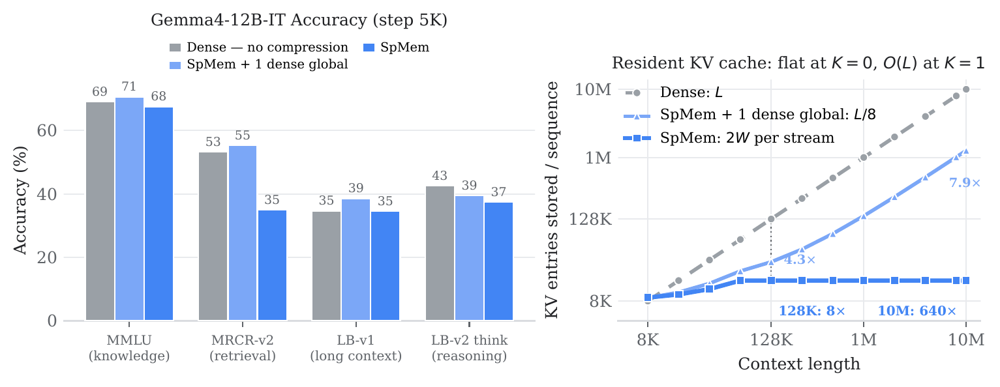
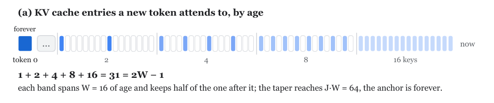
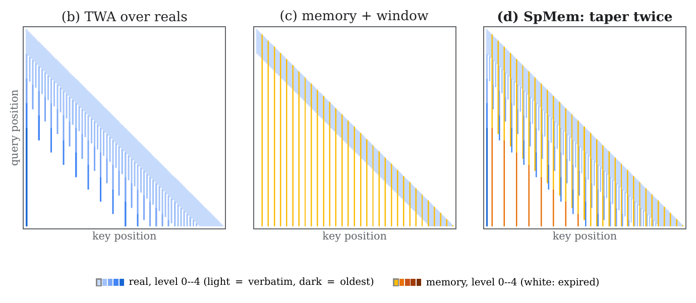
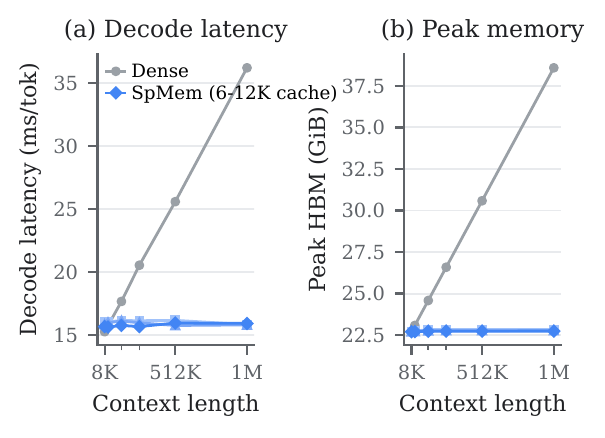

# SpMem: Sparse Attention via Memory Tokens

This software project accompanies the research paper *SpMem: Sparse Attention via Memory
Tokens* (link to be added on publication).

Most sparse attention methods store the entire KV cache and are sparse only in how they *read* it,
so the cache still grows with the context. SpMem keeps the cache itself fixed-size.

On the global-attention layers, SpMem appends `m` **memory tokens** after every `C` real tokens.
They are ordinary tokens processed by the ordinary transformer: no compressor produces them and no
selector picks among them. Training is next-token prediction under a modified attention mask, and
decoding uses that same mask. Real and memory tokens are both held under one fixed retention rule,
**Tapered Window Attention** ([`twa/`](twa)), which keeps the most recent `W` tokens and halves
the number retained with each further window of age. At a 128K context an SpMem layer holds about
16K entries against dense attention's 128K, and that number does not grow with the context.

<p align="center">
  
</p>

## How it works

<p align="center">
  
  
</p>

**(a)** What a new token can attend to, by age `q − k`: the most recent `W` keys verbatim, then
levels that each span `W` of age with half the keys of the one before, `2W − 1` entries in all,
plus one permanent anchor. **(b)** That rule as a mask over real tokens. **(c)** Memory tokens
(orange) over a sliding window: every summary is kept, so the memory cache grows with the sequence.
**(d)** SpMem: the same rule applied to the memory tokens too, which thin and expire like the reals
but reach `r = C/m` times further per slot.

1. **Insert at the embedding.** `insert_memory_tokens` expands a `[B, L]` stream of real tokens to
   the augmented `[B, L + ⌊L/C⌋·m]` one, placing `m` memory markers after each full chunk, per
   document in a packed batch. A memory token's vector comes from a dedicated trainable
   `mem_weight [m, d]`, not a vocabulary row: the embedding is tied to the LM head, so a reused row
   would be pushed down as an unpredictable class at every real position.
2. **Attend under one rule.** On a global layer, key `k` is resident for query `q` iff `q ≥ k` and
   either `k` is the anchor or the level it has aged into, `⌊(q − k)/W⌋`, is at most
   `min(ν₂(k + c), J − 1)` (`ν₂` the 2-adic valuation, `c ∈ {0, 1}` the layer's coset,
   `J = log₂ W`). It is monotone and closed-form in `(q, k)`, so the training mask and the decode
   cache are two readings of one equation.
   - A **real** query sees the reals the taper retains and the memory the memory taper retains.
   - A **memory** query sees the `W` reals ending at its chunk, earlier memory under the memory
     taper, and its own chunk's `m` siblings in both directions.
3. **Drop before the head.** Memory positions are gathered out after the transformer, so no logit
   is ever computed at one and the loss sees only real tokens. Sliding-window layers are left as
   they are and simply see memory tokens inside their window.

## Footprint and reach

Each global layer holds two tapered caches, and neither depends on the context length `L`:

| | slots | reach |
|---|---|---|
| reals | `2W − 1` | `W·log₂ W` reals |
| memory | `2·W_mem − 1` | `r·W_mem·log₂ W_mem` reals |

At the default geometry (`W = W_mem = 4096`, `C = 8`, `m = 1`, the memory taper sized to a 128K
training length) that is 8,191 + 7,681 = 15,872 slots against a dense 131,072. Reals reach 49,152
tokens back; the memory cache covers the rest of the 128K, and its window can be widened at
inference without retraining.

Memory tokens add no decoding steps: at a chunk boundary they enter the same forward pass as the
chunk's last real token, so the step is `1 + m` wide. Decoding is memory-bandwidth-bound, so a
constant resident set keeps latency and memory flat as the context grows:

<p align="center">
  
</p>

## Code map

| file | what lives there |
|---|---|
| `spmem_geometry.py` | `SpMemGeometry`, the validated layout and retention every other file reads |
| `spmem_augment.py` | `insert_memory_tokens`, where memory goes, in pure `jax.numpy` |
| `spmem_mask.py` | `spmem_mask_fn`, the training-time mask |
| `spmem_cache.py` | `SpMemCache`, the two-pool decode cache |
| `spmem_embedding.py` | `SpMemTokenEmbedding`, the `mem_weight` lookup |
| `spmem_decoder.py` | `SpMemDecoderMixin`: expand, run, gather back; prefill and decode |
| `spmem_apply.py` | `apply_spmem_to_decoder`, which installs all of the above on a built decoder |

Installing SpMem takes one call:

```python
geometry = SpMemGeometry(
    mem_chunk_size=8,  # C
    num_mem=1,  # m
    w0=4096,  # W: the real taper's verbatim window
    mem_w0=4096,  # W_mem, in summaries (omit to keep every summary)
    mem_w1=131072 // 8,  # the memory taper's reach, in summaries
)
cfg.model.decoder = apply_spmem_to_decoder(
    cfg.model.decoder,
    geometry=geometry,
    coset_assignments=(0, 1) * 4,  # one per non-KV-shared global layer
    memory_id_base=vocab_size - 1,  # reserved ids that mark memory tokens
)
```

A model with its own decoder class passes the matching `SpMemDecoderMixin` subclass as
`spmem_decoder_cls`. `keep_global_ordinals` leaves chosen global layers at full attention, a hybrid
that recovers most of the exact-retrieval gap at a still much smaller cache. No pretrained
checkpoint holds `mem_weight`, so a warm start must leave `spmem_embedding.MEM_WEIGHT_PATH` (and its
optimizer state) out of its restore request.

## Install

Dependencies are in `pyproject.toml`, with AXLearn taken from
[github.com/apple/axlearn](https://github.com/apple/axlearn):

```bash
uv sync --extra dev
```

## Tests

The suite is built around one invariant, **`forward` == `prefill` + `extend_step`**, checked over
irregular decode schedules, packed multi-document batches, ragged rows and padding, for every
memory retention. The real-to-real term is asserted equal to TWA's mipmap mask, whose own tests pin
it to hand-derived goldens.

```bash
pytest -n auto
```

## License

This sample code is released under the [LICENSE](LICENSE) terms.

## Citation

```bibtex
@article{spmem2026,
  title  = {SpMem: Sparse Attention via Memory Tokens},
  author = {Joo, Donghyeon and Hwang, Dongseong and Kim, Minsoo and Kim, Jang-Hyun and Moon, Suhong
            and Asgari, Bahar and Chiu, Chung-Cheng and Chen, Zhifeng},
  year   = {2026}
}
```

