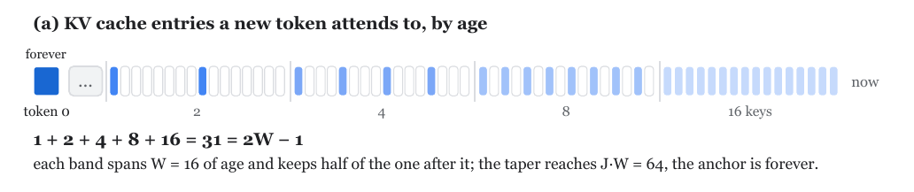
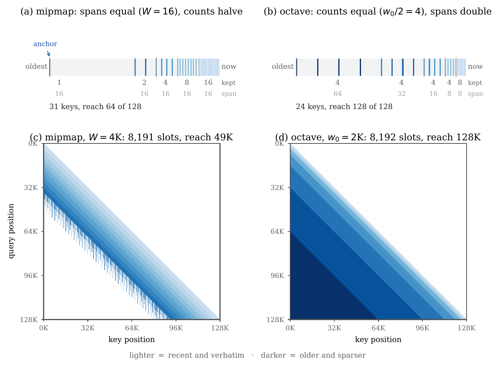

# TWA: Tapered Window Attention

A KV cache that keeps the most recent `W` keys verbatim and thins older keys with age, so it stays
a fixed size while its receptive field reaches far past `W`. The rule is closed-form in the
`(query, key)` pair, so the training-time mask and the decode-time cache are two readings of one
equation, and a model decodes with exactly the scope it trained on.

<p align="center">
  
</p>

**The rule:** the most recent `W` keys are kept verbatim, and resolution halves once per `W` of
age behind them. Level `j ≥ 1` covers ages `[jW, (j+1)W)` and keeps the keys whose position, offset
by the layer's coset `c ∈ {0, 1}`, is divisible by `2^j`. Level 0 is a ring of `W` keys and level
`j` a ring of `W/2^j`, so the pyramid sums to `W + W/2 + … + 1 = 2W − 1` slots over
`J = log₂ W` levels, the storage bound of a one-dimensional mipmap. The last level is one permanent
anchor slot (position 0 on coset 0, `W − 1` on coset 1), kept however old it gets.

Two properties make the cache exact: the rule is **monotone** (once a key drops out, no later query
asks for it), and it depends only on `(q, k)`, not on the cache's history. A tapered window also
**contains the sliding window it replaces**: level 0 is `W` consecutive keys, never thinned.

## Two retention rules

`TaperRule` selects how a budget is spent:

| rule | level `j` keeps | slots | reach |
|---|---|---|---|
| `MIPMAP` | `W >> j` keys over ages `[jW, (j+1)W)`, plus the anchor | `2W − 1` | `W·log₂ W` |
| `OCTAVE` | `w0/2` keys over ages `[2^(j−1)·w0, 2^j·w0)` | `w0 + K·w0/2` | `2^K·w0` |

<p align="center">
  
</p>

Mipmap spends a budget on resolution near the query (8,191 slots at `W = 4096` reach 49K); octave
spends it on reach (8,192 slots at `w0 = 2048` reach 128K). Alternating cosets across layers keeps
complementary halves of each tapered level, so layers decorrelate what they retain. SpMem
([`..`](..)) uses the mipmap rule for both its real tokens and its memory tokens.

## Code map

| file | what lives there |
|---|---|
| `twa_geometry.py` | `(w0, w1)` in, `levels` and `slots` out: the only place the cache size is derived |
| `twa_mask.py` | `twa_mask_fn`, the training-time mask, and `taper_survives`, the shared predicate |
| `twa_cache.py` | `TWACache` and `enable_twa_attention`, which installs cache and mask together |
| `twa_apply.py` | `apply_twa_to_decoder`, which installs TWA on every global layer of a built decoder |

```python
apply_twa_to_decoder(
    model_cfg.decoder,
    coset_assignments=(0, 1) * 4,  # one per non-KV-shared global layer
    w0=4096,
    rule=TaperRule.MIPMAP,
)
```

## Tests

The suite pins the mask to hand-derived goldens for both rules, checks the cache against the mask
at every decode step, and checks `forward` against `extend_step` over ragged, prefilled and packed
batches.

```bash
pytest twa -n auto
```
